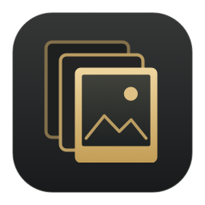
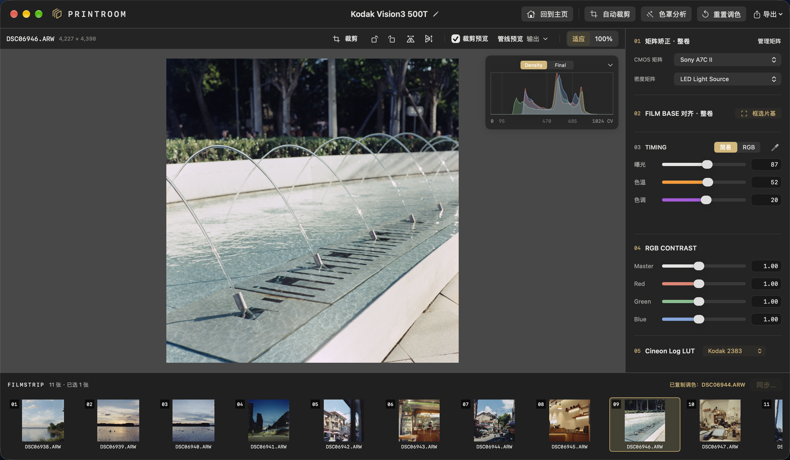
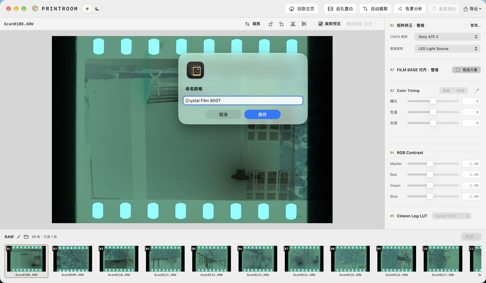
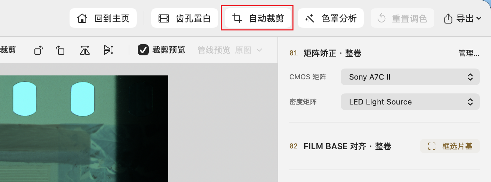
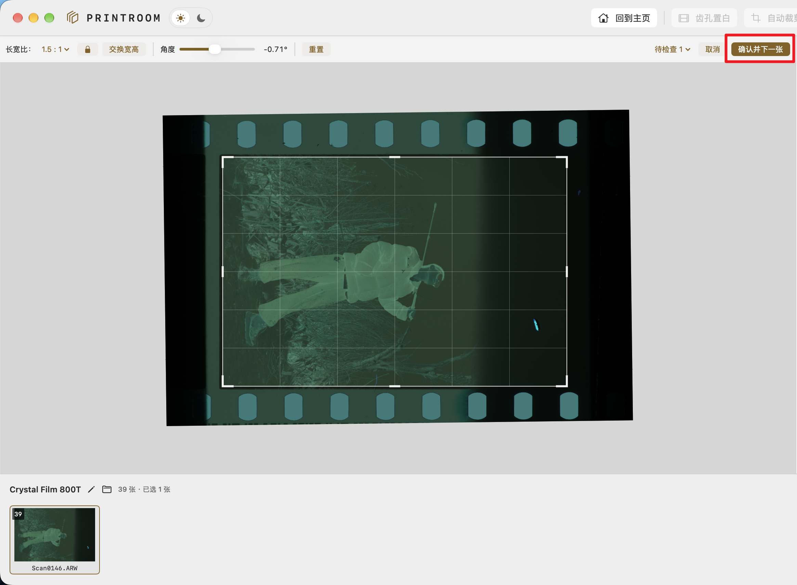
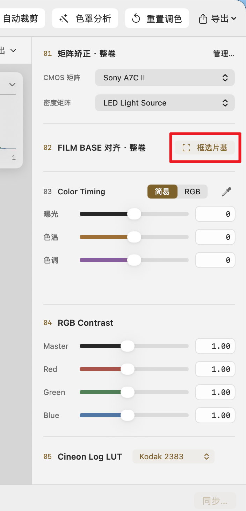
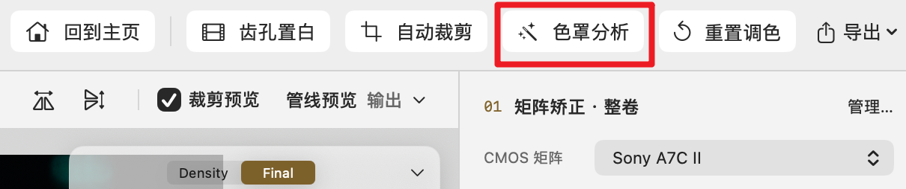

<p align="center">
  
</p>

<h1 align="center">Printroom</h1>

<p align="center">面向翻拍与扫描底片的桌面负片调色工具，支持 macOS 与 Windows。</p>

<p align="center">
  <a href="https://github.com/karasuyasabou/Printroom/releases/tag/v1.1.0"></a>
  <a href="LICENSE"></a>
</p>

<p align="center">
  <a href="#下载与安装">下载安装</a> ·
  <a href="docs/user-guide.md">使用指南</a> ·
  <a href="docs/pipeline.md">色彩管线</a> ·
  <a href="#从源码构建">源码构建</a> ·
  <a href="https://github.com/karasuyasabou/Printroom/issues">问题反馈</a>
</p>

<p align="center">
  
</p>

Printroom 按“一卷底片”来组织后期流程。它在密度域完成负片去色罩与配光：先对整卷做矩阵校正、片基对齐和色罩分析，拿到一致的色彩起点，再逐张微调并套用印片 LUT 导出。所有参数自动保存在底片文件夹内，不会改动原片。

## 特性概览

- **以卷为单位管理**：直接打开存放整卷底片的文件夹，支持线性 8-bit / 16-bit RGB TIFF 以及主流相机 RAW（经由 Adobe DNG Converter 转换），编辑记录自动保存，随时接着调。
- **密度域去色罩与配光**：提供卷级 CMOS 矩阵与密度矩阵（数字 mask）、片基取样对齐，以及整卷色罩分析；逐张支持简易模式（曝光 / 色温 / 色调）与 RGB Timing、RGB Contrast 和中性点吸管。
- **电影印片外观**：内置 Kodak 2383 与 Fujifilm 3513DI 两款 Cineon Log LUT，还原接近传统印片的明暗曲线与色彩过渡。
- **顺手的批处理与导出**：支持整卷自动裁剪、手动微调、齿孔置白、多选同步与整组撤销；可导出 16-bit TIFF 或 JPG，可选 Display P3、sRGB、Adobe RGB、ProPhoto RGB 与 Rec. 2020 色彩空间。

## 下载与安装

前往 Release 页面下载最新版本：[Printroom v1.1.0](https://github.com/karasuyasabou/Printroom/releases/tag/v1.1.0)

- **macOS**（需要 macOS 14 及以上）
  - Apple Silicon（M 系列芯片）：`Printroom-v1.1.0-macOS-arm64.zip`
  - Intel：`Printroom-v1.1.0-macOS-x86_64.zip`
  - 解压后把 `Printroom.app` 拖进“应用程序”即可。由于暂未签名和公证，首次打开如遇系统拦截，在“系统设置 → 隐私与安全性”里点击“仍要打开”即可。
- **Windows**（64 位）
  - 下载 `Printroom-v1.1.0-Windows-x64.zip`，解压后直接运行 `Printroom.exe`（免安装便携版）。首次启动若触发 SmartScreen 提示，点“更多信息 → 仍要运行”即可。

> **关于 RAW 格式**：直接导入线性 TIFF 无需额外依赖；如果要导入相机 RAW（含 DNG），需要先在本机安装免费的 [Adobe DNG Converter](https://helpx.adobe.com/camera-raw/using/adobe-dng-converter.html)。

## 快速上手

第一次使用时，建议按下面五步走完一整卷：

### 1. 打开底片文件夹

在主页点击“打开底片文件夹”，选中存放这一卷底片的目录。加载完成后可以给这卷底片起个名字（只影响显示，不改原文件夹名）。

<p align="center">
  
</p>

### 2. 自动裁剪画幅

点击顶部“自动裁剪”，选好画幅比例后开始分析。把齿孔和扫描边框裁干净，后面的色罩分析才会更准。

<p align="center">
  
</p>

如果有需要复核的画面，直接拖动裁框或用 `W / A / S / D` 挪位置、`Q / E` 微调角度，确认无误后点“确认并下一张”。平时也可以随时按 `R` 重新裁当前照片。

<p align="center">
  
</p>

### 3. 取样片基

点击右侧面板的“框选片基”，在底片边缘框出一块未曝光、干净均匀的片基区域，尽量避开齿孔、编号文字和灰尘。

<p align="center">
  
</p>

### 4. 分析整卷色罩

点击顶部“色罩分析”，计算完成后选择“应用到整卷”，就能给整卷定出一个统一的基础校色。如果需要软件顺便拉齐每张的亮度，勾选“自动曝光”即可；想保留整卷相对曝光关系则可以取消勾选。

<p align="center">
  
</p>

### 5. 逐张微调与导出

用方向键 `←` / `→` 切图，在简易模式里微调曝光、色温、色调和反差；画面里有灰或白色参考物时，可以按 `I` 用中性点吸管点一下快速校色。

调完后点顶部“导出”，选好保存位置、文件格式和色彩空间即可导出当前选中照片或整卷。

更详细的用法、支持的 RAW 机型列表、快捷键和密度配光原理，请看 **[使用指南](docs/user-guide.md)**。

## 从源码构建

```sh
git clone https://github.com/karasuyasabou/Printroom.git
cd Printroom
```

- **macOS**（需要 Xcode 命令行工具与 Swift 6）：执行 `scripts/build-app.sh`，产物位于 `output/Printroom.app`；也可以直接用 Xcode 打开 `Package.swift`。
- **Windows**（需要 Swift 6、MSVC 与 .NET 8 SDK）：执行 `pwsh -File scripts/build-win-app.ps1`，产物位于 `output/Printroom-Windows-x64/` 与 `output/Printroom-v1.1.0-Windows-x64.zip`。

开发规范与测试流程见 [参与开发](CONTRIBUTING.md)。使用中遇到 Bug 或有想法，欢迎提 [Issue](https://github.com/karasuyasabou/Printroom/issues)。

## 支持作者

Printroom 目前由我个人业余维护。如果它帮你的胶片后期省了不少时间，欢迎请我喝杯咖啡：

<p align="center">
  
</p>

## 开源协议

Printroom 原创代码与文档基于 **GPL-3.0-only** 开源，详见 [LICENSE](LICENSE)；第三方组件声明见 [THIRD_PARTY_NOTICES.md](THIRD_PARTY_NOTICES.md)。
